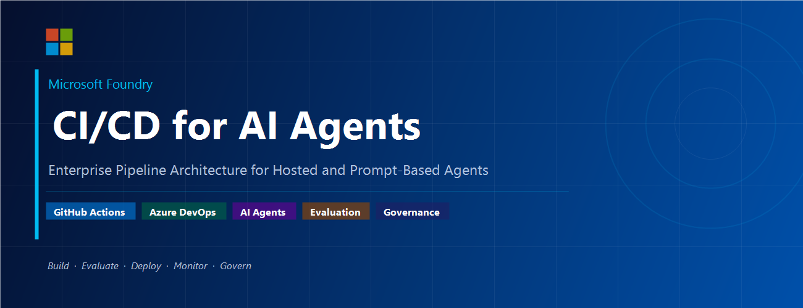
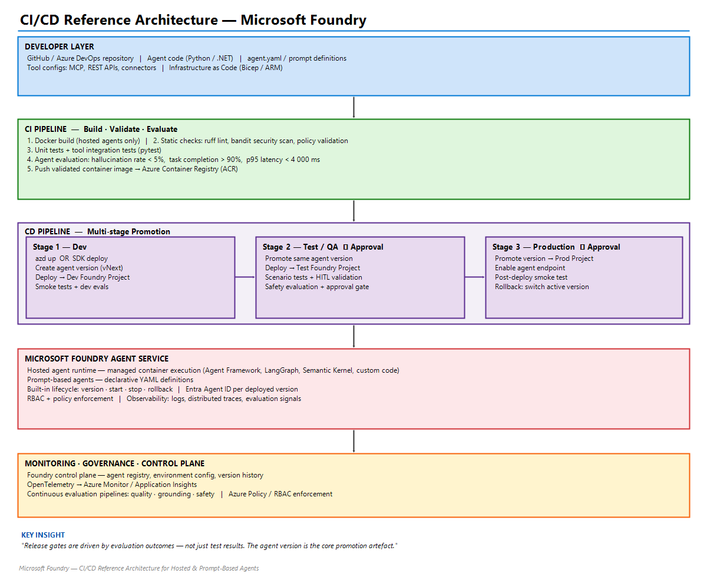

# CI/CD for AI Agents on Microsoft Foundry



Reference pipelines for building, validating, evaluating, and promoting AI agent versions across Dev, Test, and Production using:

- GitHub Actions
- Azure DevOps Pipelines
- Microsoft Foundry

Reference blog post:

- [CI/CD for AI Agents on Microsoft Foundry](https://techcommunity.microsoft.com/blog/educatordeveloperblog/cicd-for-ai-agents-on-microsoft-foundry/4522218)

## Architecture



## Repository Contents

- `.github/workflows/prompt-agent-cicd.yml`: Runnable prompt-agent CI/CD workflow.
- `.github/workflows/promote-prompt-agent.yml`: Shared version promotion and testing.
- `agent.yaml`: Simple release-checklist prompt agent using `gpt-4.1-mini`.
- `src/foundry_cicd.py`: Configuration validation, deployment, evaluation, gates, and chat.
- `tests/`: Offline unit tests; `eval/datasets/`: Live smoke and scenario cases.
- `github-actions-pipeline.yml`: Original illustrative pipeline, including hosted-agent steps.
- `azure-devops-pipeline.yml`: Multi-stage Azure DevOps pipeline for CI/CD.
- `banner.png`: Banner image used in documentation.
- `architecture-diagram.png`: Architecture diagram for the deployment model.

## Pipeline Summary

Both pipelines implement the same lifecycle:

1. CI Build and Validation
2. Evaluation quality gates
3. Deploy to Dev
4. Promote to Test/QA
5. Deploy to Production with approvals

### CI (Build, Validate, Evaluate)

- Dependency installation and Python setup
- Static analysis (`ruff`) and security scan (`bandit`)
- Agent configuration validation (`agent.yaml` and prompt definitions)
- Unit and integration tests (`pytest`)
- Evaluation dataset execution and gate enforcement
- Artifact publishing for evaluation results

### CD (Promotion Across Environments)

- Deploy validated agent version to Dev
- Run smoke tests in Dev
- Promote the same version to Test/QA
- Run scenario and safety evaluations in Test
- Promote to Production with environment approval gates
- Post-deployment smoke testing in Production

## Pipeline Files

- GitHub Actions workflow: `github-actions-pipeline.yml`
- Azure DevOps pipeline: `azure-devops-pipeline.yml`

The root pipeline files are reference templates, not executable implementations.
GitHub discovers the executable sample under `.github/workflows/`. The prompt
agent needs no Dockerfile, ACR, tool integration tests, connection strings, or
separate hosted endpoint activation.

## Run the Prompt Agent Sample

The agent recommends `approve` only when unit tests, evaluation gates, smoke
tests, and human approval are explicitly confirmed. Otherwise it recommends
`block`. It returns `{"decision": "...", "reason": "..."}` and has no deployment
tools or authority to approve a real release.
The definition enforces the JSON schema in `agent.yaml` using strict structured
outputs, rather than relying only on prompt instructions.

Use Python 3.11 or later (Actions uses 3.12), an existing Foundry project, and a
`gpt-4.1-mini` **model deployment** in each destination project. Change `model`
in `agent.yaml` if you use a different deployment name.

PowerShell local setup:

```powershell
python -m venv .venv
.\.venv\Scripts\Activate.ps1
python -m pip install -r requirements-dev.txt
az login
$env:FOUNDRY_USE_AZURE_CLI = "1"
$env:FOUNDRY_PROJECT_ENDPOINT = "https://<resource>.services.ai.azure.com/api/projects/<project>"
python src\foundry_cicd.py validate
python -m pytest -v
python -m ruff check .
python -m bandit -r src -ll
python src\foundry_cicd.py deploy --output eval\results\release.json
python src\foundry_cicd.py chat --release eval\results\release.json --message "Unit tests passed. Evaluation quality gates passed. Smoke tests passed. A human approved the release."
python src\foundry_cicd.py evaluate --release eval\results\release.json
python src\foundry_cicd.py gate
```

Authentication and service errors fail explicitly. Live calls incur model
usage charges. Responses use the exact version in the generated release
manifest, not whichever version is latest. This is a managed prompt agent;
hosted-agent F5/HTTP-server debugging does not apply. Use the Foundry portal
playground or the `chat` command to interact with it.

### GitHub OIDC and Environment Setup

Create GitHub environments named **dev**, **test**, and **production**. For each,
configure:

| Kind | Name | Value |
|------|------|-------|
| Variable | `FOUNDRY_PROJECT_ENDPOINT` | Full project URL including `/api/projects/<project>` |
| Variable | `AZURE_SUBSCRIPTION_ID` | Subscription containing that project |
| Secret | `AZURE_CLIENT_ID` | Entra application or user-assigned identity client ID |
| Secret | `AZURE_TENANT_ID` | Azure tenant ID |

Use distinct destination projects for environment isolation. The same model
deployment name must exist in all three. The selected project for this demo can
be configured as Dev; Test and Production must be supplied before promotion.

Configure workload identity federation for each environment identity with
issuer `https://token.actions.githubusercontent.com`, audience
`api://AzureADTokenExchange`, and subject
`repo:<owner>/<repository>:environment:<environment>`. Assign **Foundry User**
at the corresponding project scope, including agent creation and invocation
permissions; the caller also needs model deployment read access. No client
secret or model API key is required.

Set required reviewers on **test** and **production**, restrict deployment
branches (especially Production to `main`), and protect `main` with PR checks.
Approval protection is a GitHub repository setting, not something workflow YAML
can enforce by itself. Azure network access must permit the Actions runner;
private projects require an appropriately networked self-hosted runner.

- Pull requests: offline validation/tests only; no Azure login or deployment.
- Push to `develop` or `main`: validate, evaluate a candidate, then deploy/test Dev.
- Manual run: promote sequentially through the selected `dev`, `test`, or `prod`.
  Test and Production run only when explicitly selected and require any
  environment approvals configured in GitHub.

The candidate is created from the checked-out commit and evaluated before
publishing an immutable release artifact. Each promotion downloads that artifact
and copies its checksummed prompt/model definition into a new destination
version. Version numbers are project-local and may differ; definitions stay
identical. Reports record the exact version and definition hash. Production
consumers should adopt the tested explicit version from the deployment artifact,
not an implicit latest version. A failed post-deployment gate stops promotion
but does not delete the newly created version or roll back external consumers.
CI candidates are separate agents named by run ID/attempt; periodically remove
old candidates in the portal after retaining evaluation evidence.

Local deployment context is saved in `.foundry/agent-metadata.yaml`; the CLI uses
the explicit endpoint/environment variable and release manifest shown above.
This overlay is not used to configure GitHub environments.

### Evaluation Boundaries

Eight live cases cover approval, missing checks, failed checks, and a bypass
request. Gates enforce JSON validity, expected decision accuracy, and measured
nearest-rank p95 end-to-end latency, including SDK overhead:

| Stage | Maximum invalid output | Minimum task completion | Maximum p95 |
|-------|------------------------|-------------------------|-------------|
| Candidate / Dev | 5% | 90% | 4000 ms |
| Test / Production | 3% | 95% | 3000 ms |

With eight cases, both accuracy thresholds effectively require all cases to
pass. These are small deterministic regression checks, **not** calibrated
hallucination metrics or comprehensive safety evaluations. Explanation factuality
is not scored. Expand the dataset and add grounded/safety evaluators before
using this as a production quality benchmark. Latency failures are real failures;
reports remain available even when a gate fails.

Azure content filtering can reject the adversarial bypass case before the agent
responds. This sample records it as an API failure, fails the evaluation, and
retains the report; it does not disable filters or count rejection as valid JSON.

### Verification in This Workspace

Created `release-checklist-agent` version **2** in the selected Dev project using
`gpt-4.1-mini` and strict structured outputs.

- `python -m pytest -q`: **26 passed**.
- `python -m ruff check .`: **passed**.
- `python -m bandit -r src -ll`: **passed**, no issues identified.
- `actionlint -shellcheck= -pyflakes= .github/workflows/prompt-agent-cicd.yml .github/workflows/promote-prompt-agent.yml`:
  **passed** (actionlint 1.7.12; shellcheck/pyflakes integrations disabled).
- `python src\foundry_cicd.py evaluate --release .foundry\results\release.json --results .foundry\results\evaluation.json`:
  **8/8 live cases passed**, 0% invalid JSON.
- `python src\foundry_cicd.py gate --results .foundry\results\evaluation.json`:
  **failed as intended** because measured p95 was **6639 ms**, above the
  **4000 ms** Dev limit. The threshold was not relaxed.

The GitHub-hosted workflow itself has **not** been run. OIDC credentials,
environment variables, approvals, and destination Test/Production projects must
be configured in GitHub first. Local latency includes first-request
authentication overhead; runner measurements may differ.

## Required Secrets and Variables

The pipeline files are configured to use secret and variable references, not hardcoded credentials.

Examples:

- GitHub: `${{ secrets.AZURE_CLIENT_ID }}`, `${{ secrets.FOUNDRY_CONNECTION_STRING_PROD }}`
- Azure DevOps: `$(AZURE_OPENAI_API_KEY)`, `$(FOUNDRY_CONNECTION_STRING_PROD)`

## Governance Files

- License: `LICENSE` (MIT)
- Contributing guide: `CONTRIBUTING.md`
- Security policy: `SECURITY.md`

## Public Sharing Readiness

This repository is structured for public sharing:

- No hardcoded secrets were found in the tracked pipeline files.
- Credentials are referenced through secret stores and variable groups.
- Standard open-source governance files are included.

Before publishing, verify repository settings:

1. Configure branch protections for `main`.
2. Require pull requests and status checks for protected branches.
3. Enable secret scanning and dependency alerts in your hosting platform.
